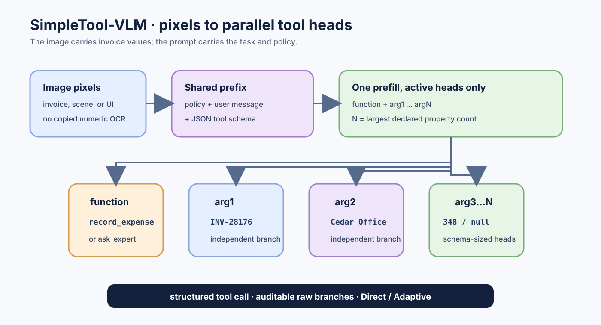
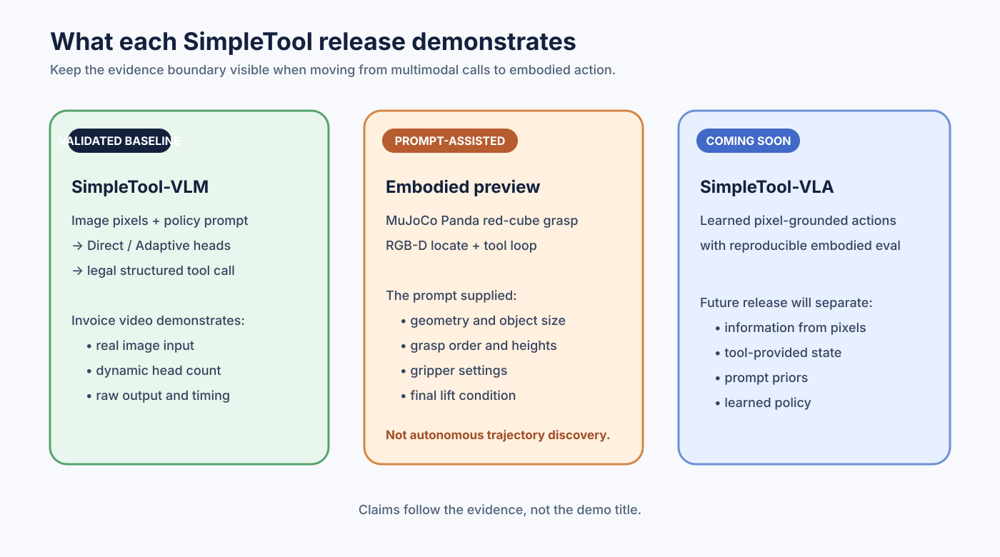

# SimpleTool-VLM

> The multimodal line is maintained separately from the ICML 2026
> `SimpleTool` / `RealtimeTool` release. The original research implementation
> remains at [HaxxorCialtion/SimpleTool](https://github.com/HaxxorCialtion/SimpleTool).

Paper: [RealtimeTool: Parallel Decoding for Real-Time LLM Function Calling](https://arxiv.org/abs/2603.00030) · [ICML 2026 paper page](https://icml.cc/virtual/2026/poster/62617) · [ICML poster](https://github.com/HaxxorCialtion/SimpleTool/blob/main/assets/realtimetool_icml2026_poster.pdf)

SimpleTool-VLM is a research release of a Qwen3-VL-4B model adapted for structured tool calls from images and text. It emits a function name and only the argument heads required by the supplied tool schema. The public release contains inference code and reproducibility notes; model weights are hosted separately on Hugging Face.

## Highlights

- Direct and Adaptive modes.
- Function plus dynamically sized `arg1...argN` heads (`N` is the maximum property count in the supplied tools).
- Image input is passed as pixels; invoice values are not copied into hidden prompt fields.
- Raw branch outputs and legality are preserved for auditing.

## Release tracks

| Track | Status | Scope |
|---|---|---|
| **SimpleTool-VLM** | Available | Qwen3-VL-4B image/text to structured tool calls; Direct is the reproducible baseline. |
| **SimpleTool-VLM-Adaptive** | Research track | Short adaptive `content` before the tool heads; experiments and limitations are documented separately. |
| **SimpleTool-VLA** | Coming soon | Vision-language-action interfaces and embodied control integrations. |

The tracks share the positional SimpleTool protocol, but they are separate
research claims. Results from the Adaptive track should not be read as a
replacement for the validated Direct baseline.

## Visual case studies

The [invoice example image](assets/invoice-example.png) and the [4090 invoice
recording](assets/simpletool-vlm-invoice-4090.mp4) show image pixels entering a
real structured tool-call loop. The video is a demonstration of the protocol,
not an OCR or accounting benchmark.

The [Panda grasp preview](assets/simpletool-vla-prompt-assisted-grasp.mp4) is
included as an embodied research preview. Its prompt explicitly supplied the
table geometry, object size, grasp order, heights, gripper settings, and a
calibrated RGB-D localization tool. It therefore demonstrates a
**prompt-assisted, tool-mediated grasp loop**, not autonomous visual planning
or learned trajectory discovery.

For interface context, see the [SimpleTool-VLM vs Jev comparison](assets/simpletool-vlm-vs-jev.svg).

## Intended use

Research on real-time multimodal structured decisions, tool calling, and embodied-agent interfaces. This is not an OCR benchmark or a general invoice accounting system. Validate every action before execution.

## Model variants

- BF16 merged checkpoint: `Cialtion/SimpleTool-VLM`.
- W4A16 checkpoint: `Cialtion/SimpleTool-VLM-W4A16` (when the upload is complete).
- FP8 checkpoint: `Cialtion/SimpleTool-VLM-FP8` (when the upload is complete).

The quantized variants use the same task adapter and tokenizer contract; backend support depends on the serving stack.

## Quick start

The lightweight HTTP implementation is in `inference/`. It accepts one PNG, text messages, and OpenAI-style function tools. See [`examples/invoice_request.json`](examples/invoice_request.json). The service returns `prediction.raw`, `prediction.legal`, `events`, and server timings.

## Adaptive track

The Adaptive track is described in [`adaptive_cot/README.md`](adaptive_cot/README.md).
It is intentionally kept separate because short generated content is not a
guaranteed reasoning trace and current distribution-shifted evaluations do not
show a stable advantage over Direct.

## VLA roadmap

[`vla/README.md`](vla/README.md) records the planned SimpleTool-VLA interface.
The prompt-assisted Panda grasp case is a research preview with an explicit
claim boundary; the autonomous VLA release is **coming soon**.

## Limitations

This release does not claim strict adapter-to-merged numerical parity, arbitrary-image robustness, OCR superiority, or native Qwen chain-of-thought. Adaptive `content` is a short task-controlled field. The included invoice demo is an end-to-end protocol demonstration, not a financial approval system.

## License and attribution

Code and release documentation are Apache-2.0. The checkpoint remains subject to the Qwen3-VL base-model license and any upstream terms. Users must review upstream terms before redistribution or commercial deployment.
